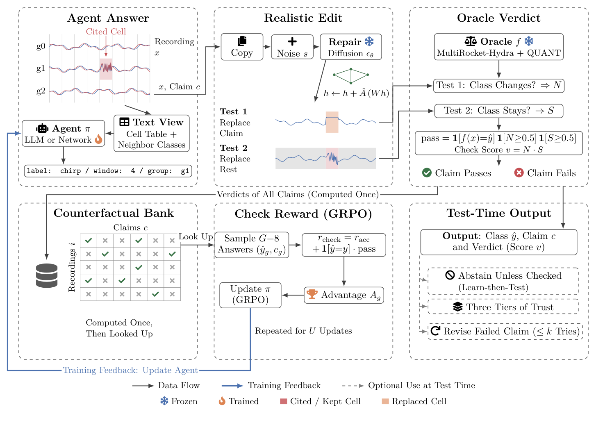

<div align="center">

# VERITAS-TS

### Learning to Cite Checkable Evidence in Multichannel Time Series Classification via Counterfactual Rewards

[](LICENSE)
[](https://www.python.org/)
[](https://pytorch.org/)
[](https://huggingface.co/Qwen/Qwen3-1.7B)
[](#citation)

**Official implementation of VERITAS-TS.**
If this code helps your research, please [**cite the paper**](#citation).

</div>

---

## Overview

Time series classifiers, including large language models (LLMs), increasingly report the evidence behind a
decision, but this evidence is rarely tested and models are not trained to make it correct. **VERITAS-TS**
checks a claimed piece of evidence with two *realistic* edits and uses the pass-or-fail verdict as a
reinforcement learning reward:

- **Test 1 (necessity):** the claimed region is replaced with content of another class; the decision should change.
- **Test 2 (sufficiency):** everything except the claimed region is replaced; the decision should stay.
- **Realistic edits:** content is *copied* from real recordings, *noised* and *repaired* by a **graph-aware
  diffusion model** that keeps physically linked channels consistent.
- **Counterfactual bank:** every claim of every recording is checked once in advance, so the check becomes a
  table lookup during training.
- **Check reward:** an LLM agent (Qwen3-1.7B + LoRA, trained with GRPO) and a small non-LLM network (trained with
  REINFORCE) learn to cite evidence that passes the check.
- **Classifier hint (optional):** cross-fitted InceptionTime class probabilities in the agent's input bring the
  agents close to the accuracy of a strong classifier while the check reward keeps its effect.
- **Test-time use:** each answer is reported with its verdict, which can be used to abstain (Learn-then-Test),
  to sort answers into three tiers, or to revise a failed claim.

<p align="center">
  
</p>

## Main Results

Six datasets (one benchmark with planted evidence and five real activity, gesture and ECG datasets), three seeds.
**Checked rate:** share of correct answers whose evidence passes the check.

| Dataset | Accuracy reward | **Check reward (proposed)** | Gain |
|---|---:|---:|---:|
| Synthetic (planted evidence) | 42.6 | **62.6** | +20.0 |
| PAMAP2 (activity) | 37.5 | **47.3** | +9.8 |
| PTB-XL (ECG) | 21.1 | **52.2** | +31.1 |
| UCI-HAR (activity) | 84.1 | **94.1** | +10.0 |
| NATOPS (gesture) | 2.5 | **15.5** | +13.0 |
| Cricket (gesture) | 57.4 | **65.5** | +8.1 |

- Realistic edits located planted evidence far better than masking (AUC **0.86** vs 0.63).
- The check reward raised the checked rate on all six datasets (mean **+15.3** points, Wilcoxon *p* = 0.016,
  confirmed by an independent judge) at equal accuracy (equivalent within 0.6 points).
- On the planted benchmark, the share of correct answers citing the true evidence rose from **50%** to **75%**.
- With the classifier hint, the LLM agent came within 0.8 points of InceptionTime's accuracy, and the check
  reward still added **+13.3** points of checked evidence.

The paper also reports the limits honestly: an occlusion-based reward localized planted evidence better, and on
real data the cited evidence is coarse (whole sensors) and largely class-level.

## Repository Structure

```text
VERITAS-TS/
├── veritas/                  # Python package
│   ├── data/                 # unified dataset format and one builder per dataset (download + conversion)
│   ├── verifier/             # graph-aware diffusion model, realistic edits, oracle and CNN judge, metrics
│   ├── agent/                # text view, check reward, selective prediction (Learn-then-Test)
│   ├── baselines/            # classical time series classifiers
│   └── grid.py               # evidence grid: time windows x channel groups, claim enumeration
├── scripts/                  # experiment entry points (training, banks, evaluation, analysis, figures)
├── experiments/              # the exact experiment queues used for the paper (see experiments/README.md)
├── docs/overview.png         # method overview
├── requirements.txt
├── CITATION.cff
└── LICENSE
```

## Installation

Tested with Python 3.12 and PyTorch 2.11 (CUDA 12.8) on Windows 11 with one NVIDIA GPU (16 GB).

```bash
git clone https://github.com/mrraselsarkar/VERITAS-TS.git
cd VERITAS-TS
python -m venv .venv
# Windows: .venv\Scripts\activate      Linux/macOS: source .venv/bin/activate

# 1) PyTorch with CUDA (pick the wheel that matches your driver, see https://pytorch.org)
pip install torch --index-url https://download.pytorch.org/whl/cu128
# 2) everything else
pip install -r requirements.txt
```

The LLM agent downloads `Qwen/Qwen3-1.7B` from the Hugging Face Hub on first use.

## Datasets

All datasets are public and are downloaded and converted by the builders in `veritas/data/`.
The raw data are **not** redistributed here; each dataset keeps the license of its source.

| Dataset | Domain | Source |
|---|---|---|
| Synthetic planted-evidence benchmark | generated | `veritas/data/synthetic.py` |
| PAMAP2 | activity | [UCI ML Repository](https://archive.ics.uci.edu/dataset/231/pamap2+physical+activity+monitoring) |
| PTB-XL 1.0.3 | ECG | [PhysioNet](https://physionet.org/content/ptb-xl/1.0.3/) |
| UCI-HAR | activity | [UCI ML Repository](https://archive.ics.uci.edu/dataset/240/human+activity+recognition+using+smartphones) |
| NATOPS | gesture | [UEA archive](https://timeseriesclassification.com/description.php?Dataset=NATOPS) |
| Cricket | gesture | [UEA archive](https://timeseriesclassification.com/description.php?Dataset=Cricket) |

```bash
python scripts/prepare_data.py                      # list the available datasets
python scripts/prepare_data.py synth_planted pamap2 ptbxl ucihar natops cricket
python scripts/make_subj_split.py --dataset ucihar  # test set of people not seen in training
```

Processed data are written to `data/processed/`, and all experiment outputs to `results/`.

## Quick Start: the Planted-Evidence Benchmark

The full pipeline on the synthetic benchmark, in which the true evidence is known:

```bash
# 1. data, diffusion model (realistic edits) and judges (oracle + independent CNN judge)
python scripts/prepare_data.py synth_planted
python scripts/train_diffusion.py --dataset synth_planted --channels 48 --layers 10 --batch-size 32 --iters 3000
python scripts/train_oracles.py   --dataset synth_planted

# 2. counterfactual bank: every claim of every recording checked once
python scripts/build_bank.py --dataset synth_planted --part train --n 1680
python scripts/build_bank.py --dataset synth_planted --part test  --n 720

# 3. text views, warm start and GRPO with the check reward (and the accuracy-reward baseline)
python scripts/make_views.py  --dataset synth_planted
python scripts/train_agent.py sft  --dataset synth_planted --targets diverse --epochs 1
python scripts/train_agent.py grpo --dataset synth_planted --reward verified --steps 200 --init sft_diverse --tag _div
python scripts/train_agent.py grpo --dataset synth_planted --reward accuracy --steps 200 --init sft_diverse --tag _div

# 4. non-LLM agent, evaluation and analysis
python scripts/train_policy.py  --dataset synth_planted --claim verified
python scripts/eval_agent.py    --dataset synth_planted --run grpo_verified_div
python scripts/eval_agent.py    --dataset synth_planted --run grpo_accuracy_div
python scripts/analyze_agent.py --dataset synth_planted --alpha 0.05
```

`--reward verified` is the check reward; `--reward accuracy` is the TimeMaster-style baseline.

## Reproducing the Paper

| Paper section | Main scripts |
|---|---|
| Q1: realistic edits vs masking | `train_diffusion.py`, `eval_verifier_synth.py`, `eval_verifier_real.py` |
| Q2: main benchmark, true evidence, reward ablations | `build_bank.py`, `make_views.py`, `train_agent.py`, `train_policy.py`, `eval_agent.py`, `analyze_agent.py`, `make_occlusion_bank.py`, `seeds_summary.py`, `benchmark_stats.py` |
| Q3: stricter check, independent judge, new people, own decision, chance/ceiling | `train_oracles_xf.py`, `judge2_eval.py`, `make_subj_split.py`, `agent_dependence.py`, `claim_baselines.py`, `make_nonb_views.py`, `review_analysis.py`, `review5_*.py`, `review6_*.py` |
| Q4: attribution methods, standard classifiers, classifier hint | `attribution_baselines.py`, `classifier_baselines.py`, `make_hint.py`, `hint_summary.py`, `hint_tables.py` |
| Q5: abstention, shift, three tiers, revision | `shift_eval.py`, `eval_retry.py`, `agent_confidence.py`, `veritas/agent/selective.py` |
| Q6: LLM vs non-LLM agent | `train_policy.py`, `agent_stats.py` |
| Figures | `make_figures.py` |

The exact order, arguments and seeds of every run are recorded in the experiment queues in
[`experiments/`](experiments/README.md). Each queue skips steps whose output already exists, so it can be
restarted at any time.

**Compute.** All experiments ran on a single 16 GB GPU. Building a counterfactual bank took 0.2-4.4 s per
recording (4-74 minutes for 1000 training recordings), and one GRPO update took 16-31 s.

---

<div align="center">

# Citation

</div>

**If you use VERITAS-TS, its code or its benchmark in your research, please cite:**

```bibtex
@misc{sarkar2026veritasts,
  title        = {{VERITAS-TS}: Learning to Cite Checkable Evidence in Multichannel Time Series
                  Classification via Counterfactual Rewards},
  author       = {Sarkar, Md Rasel and Biswas, Tarun Kumar and Ferdaus, Md Meftahul and
                  Shezan, Sk. A. and Alharbi, Fahad Radhi and Alrwaili, Ahmed Fhad and
                  Kamwa, Innocent and Shafiullah, GM and Muyeen, SM},
  year         = {2026},
  note         = {Manuscript under review},
  howpublished = {\url{https://github.com/mrraselsarkar/VERITAS-TS}}
}
```

> The entry will be updated with the journal reference once the paper is published.
> GitHub's **"Cite this repository"** button (from [`CITATION.cff`](CITATION.cff)) gives the same reference in
> APA and BibTeX.

---

## License

This project is released under the [MIT License](LICENSE). The datasets are subject to the licenses of their
original providers.

## Contact

**Md Rasel Sarkar** (corresponding author), University of New South Wales, Canberra, Australia —
m.sarkar@unsw.edu.au · [ORCID 0000-0003-0516-8593](https://orcid.org/0000-0003-0516-8593)

Questions and bug reports are welcome through [GitHub Issues](https://github.com/mrraselsarkar/VERITAS-TS/issues).

## Acknowledgments

The authors thank the providers of PAMAP2, PTB-XL, UCI-HAR and the UEA multivariate archive, and the developers
of [aeon](https://www.aeon-toolkit.org/), [Hugging Face Transformers](https://github.com/huggingface/transformers),
[TRL](https://github.com/huggingface/trl), [PEFT](https://github.com/huggingface/peft) and
[Qwen3](https://huggingface.co/Qwen/Qwen3-1.7B).
